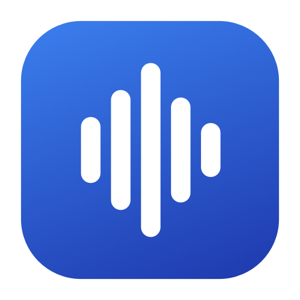
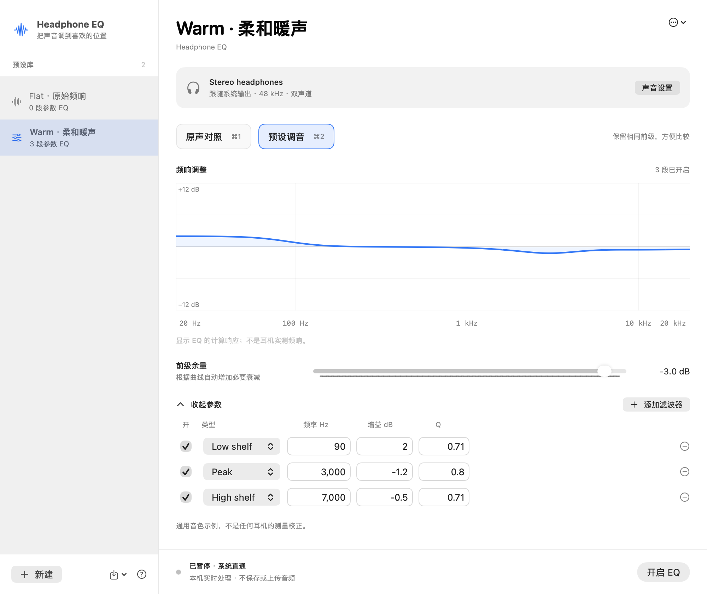

<p align="center"></p>
<h1 align="center">Headphone EQ</h1>
<p align="center">A small, local-first parametric equalizer for macOS.</p>
<p align="center"><a href="https://github.com/sm-yjr/headphone-eq/actions/workflows/verify.yml"></a>  <a href="LICENSE"></a></p>

[中文说明](docs/README.zh-CN.md) · [Download preview](https://github.com/sm-yjr/headphone-eq/releases) · [Privacy](PRIVACY.md) · [Validation](docs/validation.md)

Headphone EQ processes the current system output with up to 16 parametric filters. Import a headphone correction you trust, make small changes, and compare it against the original response while keeping the same preamp attenuation.

Built with SwiftUI, Core Audio process taps and a small C DSP engine. No virtual audio driver, account, subscription, network client or audio files saved by the app. This is an independent project; it does not contain eqMac code or assets.



*Rendered from the actual SwiftUI view with generic presets; see [validation](docs/validation.md).*

## What it does

- Peak, low-shelf and high-shelf filters with frequency, gain, Q and individual enable switches.
- Paste or import Equalizer APO parameter text; import/export Headphone EQ JSON and export APO text.
- Create, duplicate, rename and edit a local preset library. Remember a selected preset for each output device.
- Compare original / EQ using **⌘1 / ⌘2**; **⌘E** starts or pauses processing. Both comparison states retain the same preamp. This is **not perceptual loudness matching**.
- Compute conservative frequency-domain headroom, crossfade parameter changes over 25 ms, show output peaks and count clipped / invalid samples.
- Use a menu bar control and a reversible, 10-second attenuation check to verify the actual playback route.
- Pause when the output or sample rate changes, or when the Mac sleeps. Confirm the output and restart explicitly.

## Install the preview

Requires **macOS 14.4 or later**. The downloadable app is a **universal binary** for Apple silicon and Intel. The current interface is in Simplified Chinese; filter names and preset files also support English.

1. Download the ZIP from [Releases](https://github.com/sm-yjr/headphone-eq/releases), extract it and move **HeadphoneEQ.app** into Applications.
2. This preview is **Developer ID signed, but not notarized by Apple**. Gatekeeper may prevent opening it. If you prefer an Apple-notarized distribution, wait for a future release or build the source yourself. No protection-disabling commands are required or recommended by this project.
3. Select your headphones in macOS Sound settings. Open the app, choose a preset and click **开启 EQ**.
4. Allow **system audio recording** when macOS asks. The tap processes sound in memory; the app does not write or upload the audio.
5. Play music. Compare **原声对照** and **预设调音**. If you cannot hear a difference, use the stethoscope button: it lowers the processed signal by up to 30 dB and restores it automatically after 10 seconds.

Start with a moderate system volume. **Pausing or quitting restores direct system playback and removes the preamp attenuation, so playback can become louder.** The same is true after an output change or sleep. The app starts paused and does not install a login item.

## Bring your own correction

The app includes **Flat** and **Warm**, two original, generic examples. Warm is a tone adjustment, not a measured correction for a particular headphone.

Third-party measurement presets are **not bundled or relicensed**. Obtain them from their authors and follow their terms. For example, [oratory1990's own preset directory](https://www.reddit.com/r/oratory1990/wiki/index/list_of_presets/) contains headphone-specific recommendations and usage terms. Select the correct model, ear-pad condition and operating mode. Do not stack an app preset with another system EQ or an active headphone EQ unintentionally.

Supported APO subset:

```text
# Original generic tone example, not a headphone measurement
Preamp: -3 dB
Filter 1: ON LSC Fc 90 Hz Gain 2 dB Q 0.71
Filter 2: ON PK Fc 3000 Hz Gain -1.2 dB Q 0.8
Filter 3: OFF HSC Fc 7000 Hz Gain -0.5 dB Q 0.71
```

Only `Preamp`, `PK` / `PEQ`, `LSC` and `HSC` **with Q** are accepted. Unsupported directives are rejected with a line number rather than partially applied. PDF, GraphicEQ, convolution, bandwidth/slope notation, channel routing and bare `LS` / `HS` forms are not supported. See [preset format](docs/preset-format.md).

## Build and verify

Install Xcode or Apple's Command Line Tools with **Swift 6 or later**, then:

```sh
git clone https://github.com/sm-yjr/headphone-eq.git
cd headphone-eq
./script/verify.sh
./script/build_and_run.sh
```

A local build is ad-hoc signed by default. For an optimized universal app:

```sh
CONFIGURATION=release UNIVERSAL=1 ./script/build_and_run.sh --build-only
```

The bundle is written to `dist/HeadphoneEQ.app`. `script/package.sh` generates a universal ZIP and SHA-256 checksums. The scripts explicitly select SwiftPM's native build backend for compatibility with Command Line Tools installations; newer Swift toolchains may emit a deprecation warning. No package dependencies are downloaded.

Maintainers can opt into Developer ID signing with `HEADPHONE_EQ_SIGNING_IDENTITY`, and Apple notarization with a pre-existing Keychain profile named by `HEADPHONE_EQ_NOTARY_PROFILE`. Credentials never belong in the repository. See [release instructions](docs/releasing.md).

## Limits and troubleshooting

- Supports stereo, little-endian Float32 output streams at 44.1–384 kHz. Actual compatibility depends on the device and macOS. Verified hardware and untested cases are listed in [validation](docs/validation.md).
- Bluetooth headset microphone / call mode is not supported. If enabled, choose a separate microphone and reconnect the stereo music output yourself.
- This applies to the default output only. Protected media and some apps may not expose audio to a process tap. AirPlay, HDMI multi-channel, aggregate-device setups and exclusive-mode players have not been validated.
- Frequency response plots describe the **digital filters**, not the acoustic response of your headphones. Digital counters do **not** measure acoustic THD, seal, pad wear or resonance.
- Headroom uses a sampled response with a 0.8 dB margin; it is not a true-peak limiter. A final sample clamp prevents output above ±1 and counts every clipped sample. If the warning appears, lower the preamp and listen at a moderate level. Curves requiring more than 60 dB attenuation stop processing.
- The app deliberately pauses after a device change and has no automatic restart, updater, convolution, room simulation or spatial audio engine.
- If audio is silent, pause the app, confirm the physical output and the macOS system-audio permission, then retry. The app refuses to start alongside eqMac to avoid stacking EQ.

## Contribute and license

Bug reports, focused fixes and accessibility / localization improvements are welcome. See [CONTRIBUTING](CONTRIBUTING.md) and [SECURITY](SECURITY.md).

Copyright © 2026 Headphone EQ contributors. Source code, original examples, icon and documentation are licensed under **GNU GPL version 3 only** (`GPL-3.0-only`); see [LICENSE](LICENSE). Apple system frameworks retain their own licenses. Imported user presets retain their authors' rights. See [THIRD_PARTY](THIRD_PARTY.md).
